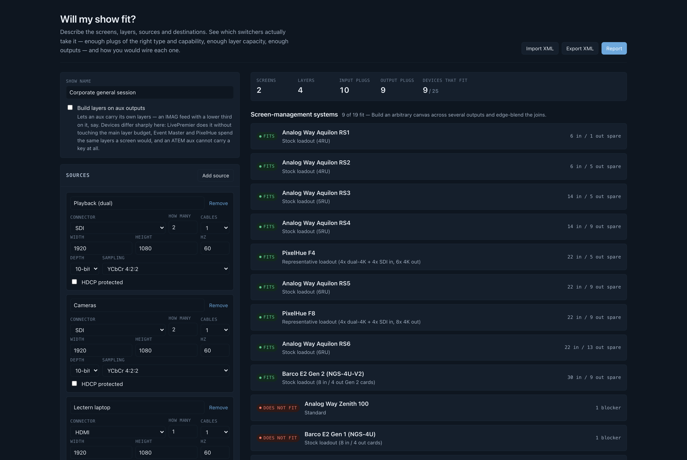

> **AI-assisted project.** This codebase was created with [Claude](https://claude.com/claude-code)
> (Anthropic), directed and reviewed by a human author.
> Every figure in it comes from published vendor documentation and is cited on the device that
> uses it, and a test fails the build if anything claims to be `documented` without a citation.
> But **none of it has been verified against hardware, and no show has ever been built from a
> topology this tool proposed**, so treat a "fits" as a shortlist, not a purchase order. See
> [The honest bit](#the-honest-bit).

# Will my show fit?

**Live at [willmyshowfit.com](https://willmyshowfit.com)**, with nothing to install.

Describe a show (screens, layers, sources, destinations) and find out which video switchers will
actually take it. That means more than "does the input count add up": it checks whether there's a
physical plug of the right type and capability for every signal, whether the layer budget covers
the layers, and whether the canvas fits the chassis. Then it proposes a wiring topology for each
switcher that fits.

Nothing is uploaded. There's no backend to upload it to.



<sub>A corporate general session (two screens, four layers, ten input plugs) checked against the device library: nine fit, with the spare inputs and outputs each would have, and the blocker on the ones that don't. The screenshot is from when the library had twenty-five switchers. It has thirty-seven now, and the same nine fit.</sub>

## What it checks

**Plugs, as a matching rather than a count.** Twelve inputs and twelve sources isn't an answer:
four SDI cameras and two SDI plugs is a "no", and a count will never spot it. Every signal is
matched to a specific connector, respecting capability. A 4K60 source doesn't go into an HDMI 1.4a
plug, 4:4:4 doesn't go down SDI, and a DisplayPort link budget is checked as well as its pixel
clock.

**The plugs that aren't what they look like.** A Midra 4K output is an HDMI socket *and* a
12G-SDI socket carrying the same picture: that's one output, not two. Its inputs 1 and 2 are HDMI
*or* 3G-SDI, so pick one. Counting the sockets on the back panel overstates that chassis by a
third.

**The wide-screen layer penalty.** Analog Way quotes its layer counts "depending on the screens
setup", and this is what that phrase is hiding: a LivePremier scaling engine spans four output
links, so a layer on a screen wider than four outputs takes a second layer link and costs twice.
It's a cliff at five outputs, not a slope. Going from a four-output blend to a five-output one
doubles that screen's entire layer bill, which is how a show runs out of chassis when the headline
layer count looked like plenty.

**Layer capacity in each vendor's own arithmetic.** Analog Way charges a 4K mixing layer twice
what it charges a DL/2K one. Barco's ladder is 4K : DL : 2K = 1 : 2 : 4. PixelHue budgets layers
**per output card**, so an F8 advertising sixteen 4K layers still can't put three on a screen that
lives on one card. None of these are modelled or derived; they're each vendor's published numbers,
cited.

**Card capacity, which isn't the connector count.** This is the limit that catches people out. A
Barco Event Master Gen 1 card has four connectors and takes exactly **one** 4K60 signal between
them (Barco's own words are "1 4K60p or 4 HD"), so a single 4K60 source eats the whole card and
strands its other three sockets. An E2 Gen 1 shows 32 input connectors and has eight 4K60 inputs.
An E2 Gen 2 shows twelve HDMI 2.0 inputs and can carry 4K60 on eight of them, because they sit on
cards rated two apiece.

**The backplane, separately.** The chassis caps below the sum of its cards: an E2 Gen 1 has four
output cards rated one 4K60 each and is still limited to three 4K outputs. Both limits are
modelled, and a multi-cable 4K60 counts as one signal, not as its cables.

**Canvas and throughput.** Barco's live effects canvas in megapixels, with the PGM-only trade-off
offered when the show only fits that way. Analog Way's program throughput figure.

**Dual- and quad-cable signals.** A 4K60 feed on two cables is two half-rate signals, which is why
it fits plugs that 4K60 doesn't.

**Passive adapters**, where one actually works (HDMI↔DVI-D is the same TMDS signalling), and it
says so in the patch list rather than pretending the plug matched.

## Layers on aux

It's a global toggle. Off, every aux is a plain scaled feed. On, auxes can carry their own layers,
and the devices go very different ways:

| | |
|---|---|
| **Analog Way LivePremier** | Free. Documented outright: layers on aux use adjacent unused outputs, not the main layer budget. |
| **Barco Event Master, PixelHue** | Charged at the same rate as an on-screen layer. |
| **Blackmagic ATEM** | Impossible. An aux is a clean routed bus; keys live on an M/E. |

That last row is why the toggle exists: it turns a "which is cheapest" list into a "which can do
this at all" list.

## Screen-management systems vs vision mixers

The database holds both, in two separate sections, because they answer different questions. A
presentation switcher builds an arbitrary canvas across several outputs and edge-blends the joins.
A vision mixer doesn't: every output is one raster, and layers are keyers over a program bus. A
7680×2160 blend isn't "too big" for an ATEM the way it's too big for a Midra. It's the wrong shape,
and the tool says so in those words.

They're in here because a lot of the shows people reach for a presentation switcher to solve turn
out to be one screen, one raster and two keys.

## Devices

**Analog Way:** Midra 4K (QuickVu, QuickMatrix, Pulse, Eikos, each mode checked
separately), Alta 4K (Zenith 100/200), LivePremier (Aquilon RS alpha, RS1–RS6),
and the two discontinued lines that are still all over the rental market:
**Midra** pre-4K (QuickVu 3G, QuickMatriX, Pulse², SmartMatriX², Saphyr, Eikos²)
and **LiveCore** (NeXtage 08/16 - 4K, Ascender 16/32/48 - 4K, SmartMatriX Ultra).
**Barco:** S3 standalone, E2 Gen 1, E2 Gen 2, ENCORE3.
**PixelHue:** F4, F8.
**Roland:** V-160HD, VR-400UHD, V-600UHD.
**Blackmagic Design:** ATEM 1/2/4 M/E Constellation 4K.

Card-based chassis are profiled against their stock loadout and, where the chassis misses,
searched for a card loadout that would take the show (see below).

The older lines show up two things the current ones don't. A pre-4K Midra has **no edge blending
at all** (soft edge arrived with Midra 4K), so a screen there has to fit on one output, which is a
different answer from "you've run out of plugs" and is reported as one. And the whole Midra
platform is a **165 MHz single-link machine**: 1080p60 and 1920x1200 fit, and 2560x1600 and
anything 4K don't, in any mode. LiveCore stops at 4K30; to check a 4K60 display against one,
describe it as a destination fed by four cables and the tool sizes the quadrants.

## Filtering, and trimming the report

**Switchers shown** sits above the verdict list: pick by brand or by model, with a one-click "only
what fits". It's the same selection the report uses, so narrowing the list to two brands while you
compare carries through rather than having to be done twice.

The full report is every selected switcher with a wiring topology under each one that fits, which
is right when you're choosing a machine and far too much when you're sending three pages to a
client who's already chosen. So the report page carries the same switcher picker plus five
sections you can drop: the input list, output list, screen breakdown, wiring topology and the
source-document links. The example show goes from about 30,000 characters to about 5,600.

Three things stay in whatever you choose. A trimmed report prints a line saying so ("showing 9 of
37 switchers … and it leaves out the source documents"), because otherwise a matrix of nine
machines reads as the whole field to whoever receives it. The caveat stays, because a report that
says what fits has to say what that rests on. And every report is signed at the foot: generated
by willmyshowfit.com, a free tool from Stoatworks Labs, with the build version and the line saying
it isn't a product of any manufacturer it names.

## Custom card loadouts

When a modular chassis doesn't fit as it ships, "doesn't fit" is only half an answer. The question
anyone specifying a build actually has is whether a different set of cards would take it, so the
tool searches for one and shows the smallest arrangement that does, with the wiring topology that
follows from it.

Loadouts are enumerated in increasing card count, so the first feasible one is minimal by
construction. Among equals, fewer distinct card types wins (four identical cards are easier to
order and swap on site than four different ones), then the tightest fit. The chosen loadout goes
through exactly the same evaluation as a stock profile, so there's no second, looser idea of
"fits".

The search is capability-aware rather than a plug count, in both directions:

- Five 1080p60 HDMI sources get one 8-plug HDMI 1.4 card, not two 4-plug
  HDMI 2.0 ones, because the cheaper card carries the format.
- One HDMI source gets a 4-connector HDMI card, not the 6-connector
  multi-format card that happens to have an HDMI plug on it.
- Six 2560x1600 outputs on an E2 Gen 1 get two Gen 2 HDMI 2.0 cards rather than
  three Gen 1 ones, because a Gen 1 card has only *two* connectors fast enough
  (see below) while a Gen 2 card has four.

Slot-position rules aren't modelled. Some vendors need particular cards in particular slots, and
Barco's Tri-combo cards are capped at 2x 4K60 despite having six connectors, so a proposal is a
starting point to check against the vendor's own slot diagram, not an order form.

### The four connectors on a card are not always equal

Barco's Gen 1 HDMI output card has four connectors, and the top two run to 297 MPix/s while the
bottom two stop at 165. So an E2 Gen 1's eight HDMI outputs are really four that carry 2560x1600
and four that don't, and a show wanting six of them needs a different card, not just a spare slot.

The chassis spec sheets only quote the 297 figure. The per-connector split is published on a
different sheet entirely, for a different product, because of course it is. This tool had the
optimistic reading until a loadout test disagreed with it.

## Import, export and reports

**XML** in and out, in this tool's own format: attributes a person can read and hand-edit, with the
round trip pinned by tests. A bad file imports as far as it can and lists what it couldn't read,
rather than throwing away forty good entries over one typo.

**Reports** as a printable page (browser "save as PDF") or a standalone HTML file, carrying the
input list, output list, screen breakdown, compatibility matrix, per-device wiring topology, and
every citation behind the verdict.

## The honest bit

**Every figure here comes from published vendor documentation and is cited on the device that uses
it. None of it has been verified against hardware.** No show has been built from a topology this
tool proposed. Vendors revise spec sheets without notice, several of the relevant numbers are
published as ranges or with conditions, and a few contradict themselves: Barco's E2 Gen 1 sheet
copies its Aux text into the Mixers row, and PixelHue's F8 sheet disagrees with itself about the
output slot count. Both are recorded in the data rather than smoothed over.

Figures that couldn't be sourced are marked `unverified` and say so in the UI, and a test fails the
build if anything claims to be `documented` without a citation. Treat a "fits" as a shortlist, not
a purchase order.

## Development

```bash
npm install
npm run dev
```

```bash
npm test
```

```bash
npm run build && npm run serve:dist
```

`npm run preview` doesn't apply `public/_headers`, so use `serve:dist` to test the CSP properly.
See [AGENTS.md](AGENTS.md) for the architecture and for what's verified and what's assumed.

## Trademarks and affiliation

Not affiliated with, endorsed by, or a product of Analog Way, Barco, PixelHue,
Roland or Blackmagic Design. All product names, logos and brands are the
property of their respective owners and are used here only to identify the
equipment being described.

<!-- selfhost:start -->
## Run your own copy

Will My Show Fit? is a static page, so hosting it yourself is one container serving
the built files — the same files the hosted copy serves, running somewhere that
still works when the venue has no internet.

**Docker.** The image is built by this repo's `docker.yml` workflow on every
push and published as `ghcr.io/stoatworks-labs/willmyshowfit`:

```bash
docker run -d --name willmyshowfit --restart unless-stopped -p 8537:80 ghcr.io/stoatworks-labs/willmyshowfit:latest
```

Or `docker compose up -d` with the [`docker-compose.yml`](docker-compose.yml)
in this repo, which maps the same port. Either way it is then at
`http://localhost:8537/`.

**Unraid.** Search Community Applications for *Will My Show Fit?* — the template is
[`templates/willmyshowfit.xml`](https://github.com/stoatworks-labs/stoatworks-unraid/blob/main/templates/willmyshowfit.xml)
in [stoatworks-unraid](https://github.com/stoatworks-labs/stoatworks-unraid), which is what the CA feed reads.

**Stoatworks Burrow** lists it under *Self-hosted*, with the compose file a
click away.

The `Dockerfile`, `docker-compose.yml`, `docker/` and the workflow are
generated from `fleet.json` in stoatworks-unraid. Change them there and
regenerate rather than editing them here.
<!-- selfhost:end -->

<!-- attributions:start -->
This project is built on other people's work — see [ATTRIBUTIONS.md](ATTRIBUTIONS.md).
<!-- attributions:end -->

## Licence

MIT — see [LICENSE](LICENSE).
